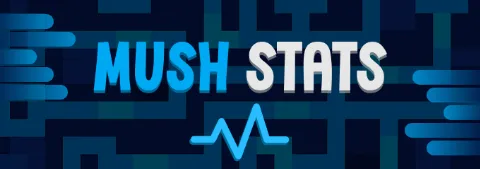

# Mush Stats

Bot de Discord não oficial para consultar estatísticas de jogadores no MushMC.



## Recursos

- `/menu [nick]`: perfil do jogador, clan, amigos, skin, parkour, tags e medalhas.
- `/bot-info`: informações do bot, links e botão para adicioná-lo.
- `/bedwars geral [nick]`: estatísticas gerais do Bed Wars, com nível, XP e seleção de modo.
- `/bedwars mensal [nick]`: estatísticas mensais do Bed Wars, com seleção de modo.
- `/bedwars semanal [nick]`: estatísticas semanais do Bed Wars, com seleção de modo.
- `/bedwars sessao`: estatísticas acumuladas desde o início da sua sessão, com seleção de modo.
- `/reiniciar sessão`: reinicia e apaga as estatísticas da sua sessão atual.
- `/bedwars diario [nick]`: estatísticas diárias do Bed Wars, com seleção de modo.
- `/bedwars missoes [nick]`: missões diárias, semanais e totais do Bed Wars.
- `/bedwars quickbuy [nick]`: imagem do menu de Compra Rápida e da hotbar do jogador.
- `/bridge geral|mensal|semanal|diario [nick]`: estatísticas do The Bridge, com seleção de modo.
- `/bridge sessao`: estatísticas do The Bridge acumuladas desde o início da sua sessão.
- `/buildbattle geral|mensal|semanal|diario [nick]`: estatísticas do Build Battle, com botões de modo.
- `/buildbattle sessao`: estatísticas do Build Battle acumuladas desde o início da sua sessão.
- `/comparar <modo> <nick1> <nick2>`: imagem comparando dois jogadores (Bed Wars, Sky Wars, CTF, The Bridge, Hunger Games, Minimush, Party, Murder, Build Battle, Quick Builders, Hide and Seek e Duels), com placar de quem está melhor em cada estatística.
- `/leaderboard <jogo> [modo] [tipo]`: imagem com o top 10 da leaderboard do jogo escolhido (Bed Wars, Duels, The Bridge, CTF etc.), por modo e período.
- Resolução automática da conta vinculada ao Discord, com fallback pelo nick do usuário.
- Select menus para alternar entre Total, Mega, Solo, Duplas, Trios, Quartetos, 1v1, 2v2, 3v3, 4v4 e 4s.
- Select menu de missões para alternar entre Total, Diárias e Semanais.
- Emojis da aplicação sincronizados automaticamente a partir de `src/emojis`.

## Comandos

| Comando | Descrição |
| --- | --- |
| `/menu [nick]` | Mostra o perfil completo do jogador. |
| `/bot-info` | Mostra informações do bot e o link de convite. |
| `/bedwars geral [nick]` | Mostra as estatísticas gerais do Bed Wars. |
| `/bedwars mensal [nick]` | Mostra as estatísticas mensais do Bed Wars. |
| `/bedwars semanal [nick]` | Mostra as estatísticas semanais do Bed Wars. |
| `/bedwars sessao` | Mostra as estatísticas acumuladas da sua sessão. |
| `/reiniciar sessão` | Reinicia as estatísticas da sua sessão. |
| `/bedwars diario [nick]` | Mostra as estatísticas diárias do Bed Wars. |
| `/bedwars missoes [nick]` | Mostra as missões diárias, semanais e totais do Bed Wars. |
| `/bedwars quickbuy [nick]` | Gera a imagem da Compra Rápida e da hotbar do jogador no Bed Wars. |
| `/bridge geral [nick]` | Mostra as estatísticas gerais do The Bridge. |
| `/bridge mensal [nick]` | Mostra as estatísticas mensais do The Bridge. |
| `/bridge semanal [nick]` | Mostra as estatísticas semanais do The Bridge. |
| `/bridge diario [nick]` | Mostra as estatísticas diárias do The Bridge. |
| `/bridge sessao` | Mostra as estatísticas acumuladas da sua sessão no The Bridge. |
| `/buildbattle geral [nick]` | Mostra as estatísticas gerais do Build Battle. |
| `/buildbattle mensal [nick]` | Mostra as estatísticas mensais do Build Battle. |
| `/buildbattle semanal [nick]` | Mostra as estatísticas semanais do Build Battle. |
| `/buildbattle diario [nick]` | Mostra as estatísticas diárias do Build Battle. |
| `/buildbattle sessao` | Mostra as estatísticas acumuladas da sua sessão no Build Battle. |
| `/comparar <modo> <nick1> <nick2>` | Gera a imagem de comparação entre dois jogadores no modo escolhido. |
| `/leaderboard <jogo> [modo] [tipo]` | Gera a imagem do top 10 da leaderboard do jogo. |

O parâmetro `nick` é opcional. Sem ele, o bot tenta usar a conta vinculada ao Discord de quem executou o comando. Os subcomandos `sessao` e `/reiniciar sessão` usam somente a conta vinculada.

## Sessões

`/bedwars sessao`, `/bridge sessao` e `/buildbattle sessao` iniciam uma sessão na primeira utilização e salvam o estado atual como base. Nas próximas utilizações, a embed mostra a diferença entre o estado atual e a base, com select ou botões para alternar entre todos os modos. `/reiniciar sessão` apaga as sessões de todos os modos.

As sessões são salvas em SQLite por padrão em `data/sessions.db`. A camada de armazenamento fica isolada em `src/services/sessionStore.js` e aceita `SESSION_DB_PROVIDER` e `SESSION_DB_PATH`; o SQLite é o provedor implementado e o fallback padrão.

## Requisitos

- Node.js 24 ou superior
- Um bot criado no Discord Developer Portal
- Token e Client ID do bot

## Instalação

```bash
git clone https://github.com/xwkf/mush-stats.git
cd mush-stats
npm install
```

Crie o arquivo `.env` a partir do exemplo:

```bash
cp .env.example .env
```

No Windows PowerShell:

```powershell
Copy-Item .env.example .env
```

Preencha as variáveis obrigatórias:

```env
DISCORD_TOKEN=seu_token
CLIENT_ID=id_do_bot
```

Opcionalmente, defina `GUILD_ID` para registrar os comandos apenas em um servidor específico:

```env
GUILD_ID=id_do_servidor
```

## Executando

```bash
npm run force
npm start
```

O `npm start` executa automaticamente o registro dos comandos antes de iniciar o bot.

Se o bot já estiver rodando, reinicie-o após alterações em comandos ou componentes.

## Scripts

| Script | Função |
| --- | --- |
| `npm start` | Registra os comandos e inicia o bot com watch mode. |
| `npm run dev` | Igual ao `npm start`. |
| `npm run force` | Força o registro dos comandos e remove duplicatas. |
| `npm run deploy` | Também registra os comandos usando a mesma lógica anti-duplicação. |
| `npm run start:prod` | Registra os comandos e inicia o bot sem watch mode. |

## Como os comandos são registrados

Os comandos são registrados globalmente com suporte a user install (`integration_types` e `contexts`), permitindo uso em servidores, DM do bot e canais privados. Comandos antigos de servidor são removidos para evitar duplicação.

Se um comando não aparecer no Discord após o registro, pressione `Ctrl+R` ou reinicie o cliente. A atualização de comandos globais pode levar alguns instantes para refletir no cache do cliente.

## Estrutura do projeto

```text
src/
  commands/          Comandos de barra
  components/        Botões, selects e modais
  constants/         Tags, medalhas e outros dados fixos
  core/              Loader e logger
  data/              Links e registro de emojis (gerados em tempo de execução)
  emojis/            Imagens sincronizadas como emojis da aplicação
  events/            Eventos do Discord
  handlers/          Carregamento de comandos e componentes
  services/          API do Mush, embeds e resolução de jogadores
  utils/             Utilitários compartilhados
  config.js          Configuração via variáveis de ambiente
  force-deploy.js    Registro imediato e anti-duplicação
  index.js           Entrada do bot
```

## API utilizada

- `GET https://mush.com.br/api/player/{name|uuid|profileid}`
- `GET https://mush.com.br/api/player/name/{username}/parkour`
- `GET https://mush.com.br/api/player/name/{username}/missions`
- `GET https://mush.com.br/api/player/name/{username}/bedwars` (`quick_buy_layout` e `hotbar`)
- `GET https://mush.com.br/api/player/{identifier}?period={daily|weekly|monthly}` (`stats.duels` para o The Bridge e `stats.buildbattle` para o Build Battle)
- `GET https://mush.com.br/api/games/bedwars/xptable`
- `GET https://mush.com.br/api/leaderboard/bedwars`
- `GET https://vzge.me/full/512/{uuid}.png` (skin)
- `GET https://raw.githubusercontent.com/PrismarineJS/minecraft-assets/master/data/1.8.8/{items|blocks}/{textura}.png` (ícones dos itens)

Este projeto não é afiliado ao MushMC.
